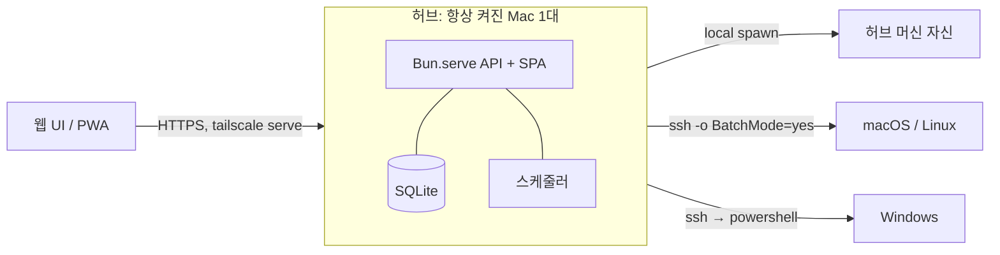

# neul v2 설계

> **늘**: 내 개발 머신들을 한 곳에서 보고, 맞추고, 실행하고, 지켜본다.

- 작성: 2026-10-14
- 상태: P0–P2 배포 (P2 iPhone PWA 푸시 확인)
- 이전 버전: `archive/v1` 태그 (Go server/agent + React, 2026-05~07)

## 1. v1에서 배운 것

v1은 "웹 control plane + 상주 agent + 선언적 reconcile"을 hosted/self-hosted OSS 제품으로 만들려다 주 사용 흐름을 끝내 완성하지 못했다.

| v1에서 일어난 일 | v2의 대응 |
|---|---|
| 온보딩(pair code → enroll wizard → `neul login`)을 13일에 세 번 재설계, 최종안은 미구현 | 등록 = SSH 별칭 입력 + 접속 테스트. pairing·로그인·세션 없음 |
| 상주 agent의 launchd 설치, 바이너리 경로, `.pkg` 서명·공증에서 막힘 | 머신에 설치할 것 없음. 허브가 SSH로 접속해 스크립트를 stdin으로 실행 |
| 빈 DB에서 desired state를 작성 → 기존 dotfile과 내용이 다르면 첫날부터 `blocked` | **adopt-first**: 먼저 수집하고, 현재 값을 desired로 "채택"하는 것이 기본 흐름 |
| `latest`만 적용 가능한데 고정 버전 입력을 허용 → 영구 `blocked` 누적 | 적용할 수 없는 desired state는 UI와 API에서 만들 수 없게 막는다 |
| agent가 drift를 스스로 판정해 보고, idempotency key로 중복 제거 → 수정 커밋 반복 | 허브가 수집 결과와 desired를 직접 비교해 판정 |
| profiles/segments 테이블만 있고 머신별 desired state 미구현 | desired state는 처음부터 "적용 대상 머신 목록"을 가진다 |
| Linux 어댑터 0개, macOS만 동작 | 단계마다 macOS·Linux를 함께 검증한다 |
| 코드보다 계획·문서·테스트가 많음 (34k줄 중 과반) | 단계마다 실제로 쓰는 기능을 먼저 만든다. 문서는 이 파일 하나 |

가져가는 것: "서버는 명령이 아니라 원하는 상태를 다룬다", 상태 어휘(`in_sync`/`drifted`/`pending`/`blocked`/`unknown`), Homebrew 적용 시 `HOMEBREW_NO_AUTO_UPDATE` 고정·적용 후 재확인, dotfile 적용 시 allowlist·atomic write·기존 파일 백업.

## 2. 목표와 비목표

**목표**

- 사용자 1명이 소유한 개발 머신 몇 대(현재 macOS 2, Arch Linux 1, Windows 1)를 관리한다.
- 네 가지 기능: 상태 가시화, 원격 실행, 모니터링·알림, 설정 배포(패키지·도구·파일·키).
- 기준 원본은 허브의 DB. 편집은 웹 UI에서 한다.

**비목표**

- 여러 사용자, 권한 모델, hosted 서비스, 외부 배포용 설치 패키지
- 상주 agent 바이너리
- E2E 시크릿 암호화 (허브가 복호화할 수 있는 at-rest 암호화로 충분)
- Windows에 대한 설정 배포 (Windows는 상태 수집까지만)

## 3. 구조



- **허브**: Bun 단일 프로세스. `Bun.serve`가 API와 SPA(HTML import 번들)를 함께 제공한다. 저장소는 `bun:sqlite`.
- **전송(transport)**: 머신마다 하나.
  - `local`: 허브 머신 자신. `sh -s`를 직접 spawn.
  - `ssh`: 시스템 `ssh` 명령. 사용자 `~/.ssh/config`의 별칭·키를 그대로 쓴다. 항상 `-o BatchMode=yes -o ConnectTimeout=10`.
- **플랫폼**: `posix`(macOS·Linux) 또는 `windows`. 등록할 때 자동 판별하고 사용자가 바꿀 수 있다.
- **보고 스크립트 (선택, 미구현)**: 잠자기·네트워크 단절 동안의 이벤트를 허브에 밀어 넣는 짧은 셸 스크립트(launchd/systemd 타이머 + `curl`). 허브 쪽 기능이 이것에 의존하지 않는다.
- **인증**: 허브는 `127.0.0.1`에만 바인딩하고 `tailscale serve`로 tailnet에 HTTPS 공개한다.
  - 요청에 `Tailscale-User-Login` 헤더가 있으면 `NEUL_ALLOWED_LOGINS`(쉼표 구분)에 들어 있어야 한다. 아니면 403.
  - 헤더가 없으면 loopback 요청만 허용한다(허브 머신 위의 로컬 접근).
  - 허브 머신 자체가 신뢰 경계다. 그 위의 다른 프로세스는 신뢰한다.

## 4. 수집

### 4.1 프로토콜

허브는 스크립트 본문을 stdin으로 보내고 감시할 git 저장소와 경로 패턴을 인자로 넘긴다.

- posix: `ssh <alias> sh -s -- <저장소 수> <저장소>... <pattern>...` (local은 `sh -s -- ...`)
- windows: `ssh <alias> powershell -NoProfile -NonInteractive -Command -`

스크립트(`src/collector/collect.sh`, `collect.ps1`)는 **읽기 전용**이며 다음 형식으로 출력한다.

```
@@ <section>
<section lines>
...
@@ end
```

`@@ end`가 없으면 출력이 잘린 것으로 보고 실행을 `error`로 기록한다. 실행 제한 시간은 머신당 60초.

| section | 형식 | 플랫폼 |
|---|---|---|
| `meta` | `key=value` 줄. `schema`, `hostname`, `os`, `kernel`, `arch`, `user`, `collected_at`, `os_name`, `model`, `cpu_count`, `uptime_s`, `load`(3개, 공백 구분), `mem_total_b`, `mem_available_b`, `disk_path`, `disk_total_b`, `disk_used_b`, `disk_available_b`, `battery`(`<percent> <state>`) | 전부 |
| `brew_formulae` / `brew_casks` | `brew list --versions` 줄: `name ver [ver...]` | brew 있을 때 |
| `brew_leaves` | 직접 설치한 formula 이름 한 줄씩 | brew 있을 때 |
| `pacman_explicit` | `pacman -Qe` 줄: `name ver` | pacman 있을 때 |
| `pacman_count` | 전체 패키지 수 | pacman 있을 때 |
| `mise_json` | `mise ls --json` 원문 | mise 있을 때 |
| `files` | 탭 구분 `kind sha256 size link_target path`. kind는 `file`·`symlink`·`dir`·`broken`·`missing` | posix |
| `brew_outdated` | `brew outdated --quiet` 이름 한 줄씩. 마지막 `brew update` 시점의 메타데이터 기준(`HOMEBREW_NO_AUTO_UPDATE`) | brew 있을 때 |
| `pacman_updates` | `checkupdates` 이름 한 줄씩(임시 DB 동기화, 시스템 DB는 그대로). 실패하면 섹션 없음 = 알 수 없음 | `checkupdates` 있을 때 |
| `repos` | 탭 구분 `state dirty ahead path`. state는 `ok`·`missing`, dirty는 `git status --porcelain` 줄 수, ahead는 upstream보다 앞선 커밋 수(upstream 없으면 빈 값). `GIT_OPTIONAL_LOCKS=0` | posix, 저장소 설정 시 |

경로 패턴은 `$HOME` 기준 상대 경로이며 glob을 쓸 수 있다(`.ssh/config.d/*.conf`). 패턴이 아무것도 매치하지 않으면 `missing` 한 줄을 낸다.

### 4.2 결과 해석

| 결과 | 판정 |
|---|---|
| `ssh` 종료 코드 255 (접속 실패, `ConnectTimeout=10` 초과 포함) | `unreachable` |
| 전체 실행 60초 초과, 그 밖의 0이 아닌 종료 코드, `@@ end` 없음, 파싱 실패 | `error` |
| 정상 | `ok` |

머신 상태는 마지막 실행 결과로 정한다: `ok` → `online`, `unreachable` → `unreachable`, `error` → `error`, 실행 기록 없음 → `unknown`.

### 4.3 저장

- **facts**(부하·메모리·디스크·배터리·uptime)는 실행마다 바뀌므로 `runs.facts_json`에 실행별로 저장한다.
- **inventory**(패키지·mise·파일 해시)는 내용 해시가 같으면 새로 저장하지 않는다. `(machine_id, hash)`가 같으면 `last_seen_at`만 갱신한다.
- `runs`는 머신당 최근 2,000건만 남긴다. inventory는 지우지 않는다(변경 이력).

## 5. 데이터 모델

```sql
machines(
  id INTEGER PRIMARY KEY, name TEXT UNIQUE NOT NULL, alias TEXT NOT NULL,
  transport TEXT NOT NULL CHECK (transport IN ('local','ssh')),
  platform  TEXT NOT NULL CHECK (platform IN ('posix','windows')),
  enabled INTEGER NOT NULL DEFAULT 1, created_at TEXT NOT NULL,
  notify_unreachable INTEGER NOT NULL DEFAULT 1)  -- P2에서 ALTER TABLE로 추가

inventories(
  id INTEGER PRIMARY KEY, machine_id INTEGER NOT NULL REFERENCES machines ON DELETE CASCADE,
  hash TEXT NOT NULL, data_json TEXT NOT NULL,
  first_seen_at TEXT NOT NULL, last_seen_at TEXT NOT NULL, UNIQUE (machine_id, hash))

runs(
  id INTEGER PRIMARY KEY, machine_id INTEGER NOT NULL REFERENCES machines ON DELETE CASCADE,
  started_at TEXT NOT NULL, finished_at TEXT NOT NULL, duration_ms INTEGER NOT NULL,
  status TEXT NOT NULL CHECK (status IN ('ok','unreachable','error')),
  error TEXT, facts_json TEXT, inventory_id INTEGER REFERENCES inventories)

settings(key TEXT PRIMARY KEY, value_json TEXT NOT NULL)

-- P1 원격 실행
exec_runs(
  id INTEGER PRIMARY KEY, command TEXT NOT NULL, timeout_s INTEGER NOT NULL,
  created_at TEXT NOT NULL, created_by TEXT NOT NULL, finished_at TEXT)  -- 모든 대상이 끝나면 채움

exec_targets(
  id INTEGER PRIMARY KEY, run_id INTEGER NOT NULL REFERENCES exec_runs ON DELETE CASCADE,
  machine_id INTEGER REFERENCES machines ON DELETE SET NULL, machine_name TEXT NOT NULL,
  platform TEXT NOT NULL,
  status TEXT NOT NULL CHECK (status IN ('running','ok','failed','unreachable','timeout','canceled','interrupted')),
  exit_code INTEGER, started_at TEXT NOT NULL, finished_at TEXT,
  output_json TEXT NOT NULL DEFAULT '[]',  -- [{stream, data}] 도착 순서
  truncated INTEGER NOT NULL DEFAULT 0)

saved_commands(id INTEGER PRIMARY KEY, name TEXT UNIQUE NOT NULL, command TEXT NOT NULL,
  created_at TEXT NOT NULL, updated_at TEXT NOT NULL)

-- P2 모니터링·알림
alerts(
  id INTEGER PRIMARY KEY, machine_id INTEGER NOT NULL REFERENCES machines ON DELETE CASCADE,
  rule TEXT NOT NULL CHECK (rule IN ('unreachable','disk','updates','repo','files')),
  subject TEXT NOT NULL,  -- 디스크 경로·저장소 경로, 머신당 하나인 규칙은 ''
  message TEXT NOT NULL, opened_at TEXT NOT NULL, resolved_at TEXT, notified_at TEXT)
-- UNIQUE (machine_id, rule, subject) WHERE resolved_at IS NULL: 열린 알림은 하나

push_subscriptions(id INTEGER PRIMARY KEY, endpoint TEXT UNIQUE NOT NULL,
  p256dh TEXT NOT NULL, auth TEXT NOT NULL, user_agent TEXT, created_at TEXT NOT NULL)
```

설정 키: `trackedPaths`(string[]), `collectIntervalMin`(number, 기본 10), `alertRules`(`{ unreachableMin, diskPercent, updatesCount }`는 숫자 또는 null=끔, 기본 30·90·20, `trackedFiles`(기본 true), `repos`(string[])). `vapidKeys`도 settings 테이블에 있지만 `GET /api/settings`로는 나가지 않는다.

## 6. API

공유 타입은 `src/shared/types.ts`. 모든 응답은 JSON, 실패는 `{ "error": string }`과 4xx/5xx.

| 메서드·경로 | 동작 |
|---|---|
| `GET /api/me` | `{ login }` (헤더가 없으면 `"local"`) |
| `GET /api/machines` | `MachineSummary[]` |
| `POST /api/machines` | `{ alias, name?, transport?, platform? }`. 접속을 확인하고 플랫폼을 판별해 저장한 뒤 바로 1회 수집. 접속 실패면 400 |
| `PATCH /api/machines/:id` | `{ name?, enabled?, platform? }` |
| `DELETE /api/machines/:id` | 머신과 기록 삭제 |
| `GET /api/machines/:id` | `MachineDetail` |
| `POST /api/machines/:id/collect` | 즉시 수집하고 끝날 때까지 기다려 `RunSummary` 반환. 이미 수집 중이면 그 결과를 기다린다 |
| `POST /api/collect` | 활성 머신 전체 즉시 수집, `RunSummary[]` |
| `GET /api/compare` | `CompareView` |
| `GET /api/settings`, `PUT /api/settings` | `Settings` |
| `POST /api/exec` | `{ command, machineIds, timeoutS? }` → `{ id }`. 바로 실행을 시작한다. 이미 실행 중인 머신이 있으면 409 |
| `GET /api/exec` | 최근 100건 `ExecRunSummary[]` (출력 제외) |
| `GET /api/exec/:id` | `ExecRunDetail`. 실행 중이면 지금까지의 출력 포함 |
| `GET /api/exec/:id/events` | SSE. 연결마다 `snapshot`(전체 상태)으로 시작하고 `chunk`·`exit`·`done`을 보낸다. 끝난 실행은 `snapshot` 뒤 바로 `done`. 15초마다 keepalive 주석 |
| `POST /api/exec/:id/cancel` | 실행 중인 대상 모두 취소. 이미 끝났으면 409 |
| `GET /api/commands`, `POST /api/commands`, `PATCH /api/commands/:id`, `DELETE /api/commands/:id` | 저장된 명령 `{ name, command }`. 이름은 고유 |
| `GET /api/alerts?state=open\|all` | `Alert[]`. 열린 것 먼저, `all`이면 해결된 것 포함 최근 200건 |
| `GET /api/push/key` | `{ publicKey }` VAPID 공개키(없으면 만든다) |
| `POST /api/push/subscriptions`, `DELETE /api/push/subscriptions` | 이 기기의 `PushSubscription.toJSON()` 등록, `{ endpoint }`로 해제 |
| `POST /api/push/test` | 구독한 모든 기기로 테스트 알림, `{ sent, failed }` |
| `GET /sw.js`, `/icon-192.png`, `/icon-512.png` | PWA 파일(인증 없음). manifest와 apple-touch-icon은 `index.html` 번들 자산 |

## 7. 화면

- **머신 목록**: 상태, OS, uptime, 부하, 메모리·디스크 사용률, 배터리, 패키지 수, 마지막 수집 시각. "전체 수집", "머신 추가".
- **머신 상세**: facts(업데이트 대기 수, 감시 저장소 상태 포함), 최근 실행 기록(오류 메시지 포함), brew formula/cask(직접 설치 여부 표시), pacman, mise 도구(활성 버전), 추적 파일 해시. 검색 필터. 편집에서 "연결 끊김 알림" 토글.
- **비교**: 머신을 열로 한 행렬. brew formula·cask, mise 활성 버전, 추적 파일 해시. "다른 것만 보기"가 기본.
- **설정**: 추적 경로 패턴, 수집 주기, 알림 규칙(임계값·끄기, 감시 저장소), 이 기기의 푸시 구독·테스트 알림.
- **알림**(`#/alerts`): 열린 알림과 지난 알림. 헤더 메뉴에 열린 알림 수.
- **원격 실행**(`#/exec`): 대상 머신 선택, 명령·제한 시간 입력 → 확인 단계(대상과 명령 원문)를 거쳐 실행. 저장된 명령(불러오기·저장·덮어쓰기·삭제), 실행 기록.
- **실행 상세**(`#/exec/:id`): 머신별 출력 패널(stderr 구분, 상태·종료 코드·소요 시간), 실행 취소, 다시 실행(명령과 대상을 채운 확인 전 폼으로).

## 8. 단계와 완료 기준

각 단계는 끝났을 때 바로 쓸 수 있어야 한다. 완료 기준은 실제 머신에서 확인한다.

### P0 — 가시화

- 허브 머신에 launchd로 상주하고 `tailscale serve`로 tailnet에 공개된다.
- 머신을 별칭으로 추가하면 자동으로 플랫폼을 판별하고 수집한다.
- 주기적으로 수집하고, 꺼진 머신은 `unreachable`로 보인다.
- 비교 화면에서 두 Mac의 brew·mise·추적 파일 차이를 볼 수 있다.

### P1 — 원격 실행

- 머신 여러 대를 골라 셸 명령을 실행하고, 머신별 stdout/stderr를 SSE로 실시간 본다.
- 실행 기록(명령, 대상, 종료 코드, 출력)이 남는다. 자주 쓰는 명령을 저장해 다시 실행한다.
- 실행은 항상 사용자 확인 후. 허브가 스스로 명령을 실행하지 않는다.

구현:

- 명령은 stdin으로 보낸다. posix는 `ssh <alias> sh -s`(local은 `sh -s`)에 래퍼 스크립트를 보낸다. 래퍼는 수집 스크립트와 같은 PATH 보강을 하고, 명령을 별도 프로세스 그룹에서 `sh -c`로 실행한다(명령의 stdin은 `/dev/null`). 허브는 stdin을 열어 두고, 래퍼의 감시 프로세스는 stdin EOF를 받으면 그 프로세스 그룹을 kill한다. 취소·시간 초과·허브 종료 때 stdin이 닫히면 원격 프로세스도 함께 끝난다. 5초 안에 끝나지 않으면 로컬 `ssh`를 SIGKILL한다.
- windows는 `powershell -NoProfile -NonInteractive -Command -`에 `[Console]::OutputEncoding`을 UTF-8로 맞춘 뒤 명령을 보내고 stdin을 닫는다. 취소하면 로컬 `ssh`를 SIGKILL한다(원격 정리 미검증).
- 결과: 종료 코드 0 → `ok`, ssh 255 → `unreachable`, 그 밖 → `failed`. 제한 시간(기본 300초, 최대 3600초) 초과 → `timeout`, 사용자 취소 → `canceled`. 같은 머신에서는 한 번에 하나만 실행한다.
- 출력은 대상별로 stdout·stderr 합쳐 1 MiB까지만 남기고 넘으면 `truncated`. 실행 중 출력은 메모리에 두고 대상이 끝날 때 저장한다. 허브가 시작할 때 `running`으로 남은 대상은 `interrupted`로 마감한다(그 출력은 남지 않는다).
- 실행 기록은 최근 500건만 남긴다. 머신을 지워도 기록은 `machine_name`으로 남는다.

### P2 — 모니터링·알림

- 규칙: 머신 `unreachable` N분 이상, 디스크 사용률, brew/pacman 업데이트 대기 수, 추적 파일 변경, 특정 git 저장소의 커밋 안 한 변경.
- **알림은 PWA Web Push**: 웹 앱에 manifest와 service worker를 두고, VAPID 키로 허브가 직접 푸시한다(`web-push`). iOS는 홈 화면에 추가한 PWA만 푸시를 받는다(iOS 16.4+). 허브는 Apple·Google 푸시 서버로 나가는 연결만 필요하다.
- 같은 문제는 해결될 때까지 한 번만 알린다.

구현:

- 판정은 허브가 한다. 수집이 끝날 때마다 그 결과로 디스크·업데이트·저장소·연결 끊김을, 30초 tick마다 연결 끊김을 다시 본다. 연결 끊김은 마지막 실행이 실패이고 마지막 성공(없으면 등록 시각)에서 `unreachableMin`분이 지난 상태다. `notify_unreachable`이 꺼진 머신(잠자는 노트북)은 제외한다.
- 상태형 규칙(연결 끊김·디스크·업데이트·저장소)은 조건이 처음 성립할 때 알림을 열고 한 번 푸시한다. 조건이 풀리면 푸시 없이 닫는다. 판정할 수 없는 규칙(수집 실패, 업데이트 수 미상)은 열린 알림을 그대로 둔다. 규칙을 끄거나 머신을 비활성화하면 열린 알림을 닫는다.
- 추적 파일 변경은 사건형이다. 이전 inventory와 이번 inventory에 모두 있는 경로의 kind·해시·링크 대상이 바뀌면 바로 닫힌 알림으로 기록하고 푸시한다. 추적 경로 설정을 바꿔 새로 생긴 경로는 알리지 않는다.
- 푸시는 `web-push`로 보낸다. VAPID subject는 `NEUL_VAPID_SUBJECT`, 없으면 `NEUL_ALLOWED_LOGINS`의 첫 이메일(`mailto:`). TTL 24시간, tag는 머신·규칙·대상이라 같은 문제의 알림은 기기에서 대체된다. 푸시 서비스가 404/410을 주면 구독을 지운다.
- 해결된 알림은 최근 1,000건만 남긴다.

### P3 — 패키지·도구 desired state

- 대상: brew formula/cask(macOS), pacman(Arch), mise 전역 도구.
- 흐름: 수집된 현재 상태에서 항목을 "채택" → desired 항목이 되고 적용 대상 머신을 고른다 → 허브가 차이를 계산(`in_sync`/`drifted`/`pending`/`blocked`/`unknown`) → 계획(설치·제거 목록)을 보여 주고 확인 → SSH로 적용 → 즉시 재수집으로 확인.
- brew는 버전 고정을 받지 않는다. mise는 고정 버전을 받는다.

### P4 — 파일·키 desired state

- 대상: dotfile, SSH 설정, SSH 키.
- 채택: 한 머신의 파일 내용을 desired의 첫 버전으로 가져온다. 이후 웹에서 편집하면 버전이 쌓인다.
- 적용: 대상 경로의 기존 파일은 `<path>.neul-bak-<timestamp>`로 백업한 뒤 atomic write. 키 파일은 권한 `600`.
- 키·시크릿 내용은 허브 DB에 age로 암호화해 저장한다(허브 로컬 키).
- desired state 전체를 git 저장소로 내보낼 수 있다(백업·이력용).

## 9. 운영

- 실행: `bun run start` (`NODE_ENV=production`). 포트 `NEUL_PORT`(기본 7430), DB `NEUL_DB`(기본 `~/.local/share/neul/neul.db`).
- 상주·공개: 허브 머신의 개발 저장소에서 `deploy/update-hub.sh <tailscale-login>` 실행. `origin/main`을 별도 worktree `~/.local/share/neul/hub`에 받고(`deploy/install-launchagent.sh` 호출) LaunchAgent `dev.neul.hub`로 띄운 뒤 `tailscale serve --bg --https=7430 http://127.0.0.1:7430`으로 tailnet에 공개한다. 로그는 `~/Library/Logs/neul/hub.log`.
